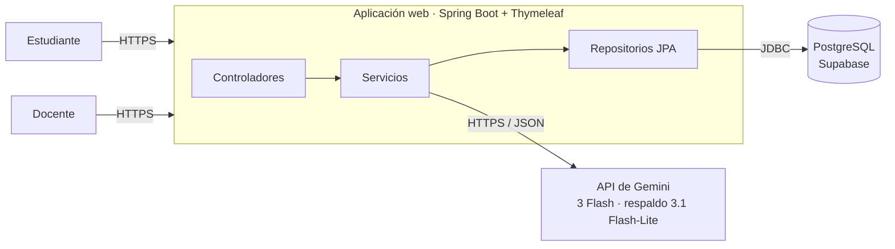

# Tutor Socrático

Prototipo de plataforma web de tutoría inteligente que acompaña a estudiantes de programación mediante el **método socrático**: el tutor no entrega el código ni la solución, sino que guía al estudiante con preguntas, pistas progresivas y analogías. A partir de esa misma conversación, la plataforma le entrega al docente métricas de seguimiento, informes pedagógicos por estudiante y una síntesis del grupo con recomendaciones para la siguiente clase.


| | |
|---|---|
| **Proyecto de grado** | Prototipo de plataforma web para la identificación de falencias y la retroalimentación docente en procesos de aprendizaje asistido por un sistema de tutoría inteligente |
| **Programa** | Ingeniería de Sistemas y Computación, Pontificia Universidad Javeriana Cali |
| **Autor** | Julio Alejandro Mazo Reyes |
| **Director** | MSc. Mario Julián Mora Cardona |
| **Año** | 2026 |

---

## Contenido

- [Tutor Socrático](#tutor-socrático)
  - [Contenido](#contenido)
  - [Funcionalidades](#funcionalidades)
    - [Docente](#docente)
    - [Estudiante](#estudiante)
  - [Arquitectura](#arquitectura)
    - [Prompt en tres capas](#prompt-en-tres-capas)
    - [Meta-etiquetas y métricas](#meta-etiquetas-y-métricas)
    - [Mecanismos de control en el servidor](#mecanismos-de-control-en-el-servidor)
  - [Tecnologías](#tecnologías)
  - [Estructura del repositorio](#estructura-del-repositorio)
  - [Modelo de datos](#modelo-de-datos)
  - [Puesta en marcha](#puesta-en-marcha)
    - [Requisitos](#requisitos)
    - [Variables de entorno](#variables-de-entorno)
    - [Ejecución local](#ejecución-local)
    - [Docker](#docker)
    - [Despliegue](#despliegue)
  - [Pruebas](#pruebas)
    - [Scripts de simulación](#scripts-de-simulación)
  - [Documentación y entregables](#documentación-y-entregables)
  - [Seguridad y privacidad](#seguridad-y-privacidad)

---

## Funcionalidades

### Docente
- **Crear clases en tres pasos** (RF-05): tema, componentes del framework **CRAFT** (contexto, rol, audiencia, formato y tono) con el botón *Sugerir Directrices CRAFT con IA*, y preguntas guía que definen la ruta de aprendizaje.
- **Compartir la clase** con un enlace único (RF-01), y pausarla, reanudarla o eliminarla.
- **Panel de Métricas Docente**: indicadores generales, hoja de ruta por pregunta guía, focos de dificultad del grupo (RF-06), síntesis pedagógica consolidada con IA (RF-07), seguimiento individual con alerta de riesgo de abandono (RF-08) e informe pedagógico por estudiante.
- **Mis Estudiantes**: directorio con la frecuencia y la duración de uso de cada estudiante, y asignación a clases.
- **Feedback Recibido** (RF-10): valoraciones, comentarios y resultados de la encuesta SUS+TAM.
- **Autenticación de dos factores** opcional (TOTP).

### Estudiante
- **Registro o ingreso desde el enlace de la clase** con el correo institucional (RF-01).
- **Chat socrático** (RF-02 y RF-03): el tutor guía por las preguntas guía del docente, sin entregar la solución.
- **Retomar la tutoría** en el punto en que se dejó, porque el historial se conserva (RF-04).
- **Feedback Profe** (RF-09) y **encuesta SUS+TAM** para evaluar la plataforma.

> El detalle de cada pantalla está en la [Guía de Gestión Pedagógica para el Docente](Entregables/Guia_Gestion_Pedagogica_Docente.pdf).

---

## Arquitectura

Aplicación monolítica **Spring Boot + Thymeleaf** (renderizado en el servidor) que se comunica con **PostgreSQL en Supabase** y con la **API de Gemini**.



### Prompt en tres capas

En cada mensaje del estudiante, `ChatService` arma el prompt con tres bloques independientes, encapsulados en `PromptCapasDto`:

| Capa | Origen | Contenido |
|---|---|---|
| **1. Fija** | `src/main/resources/prompts/capa1_socratico.md` | Reglas del método socrático. El docente no la ve ni la modifica: sin solución directa, pistas en tres niveles, una sola pregunta por mensaje, respuestas en español y confidencialidad de las instrucciones. |
| **2. Configurable** | Columnas de la tabla `Sesion` | CRAFT de la clase y preguntas guía numeradas. |
| **3. Dinámica** | Tabla `mensaje` | Historial de la conversación de la sesión actual. El informe del estudiante **no** se inyecta. |

El mensaje nuevo se agrega al final, delimitado en `<consulta_estudiante>` con una instrucción de seguridad contra la inyección de prompt.

### Meta-etiquetas y métricas

El modelo marca los eventos de la tutoría con comentarios HTML ocultos. El servidor los detecta, los elimina antes de mostrar la respuesta y los registra en la tabla `metrica`:

| Meta-etiqueta | Código | Uso |
|---|---|---|
| `GUIA_INICIADA` | 20 | Apertura de la ruta (M-02) |
| `GUIA_SUPERADA:n` | 21 | Turnos que tomó la pregunta guía *n* (M-02) |
| `RUTA_COMPLETADA` | — | Cierre de la tutoría y generación del informe |
| `ATAJO_DETECTADO` | 10 | Solicitud de la respuesta directa (M-03). También se detecta con un patrón sobre el mensaje del estudiante. |
| — | 2 | Total de mensajes de la conversación (registro de actividad) |

| Métrica | Qué mide | De dónde sale |
|---|---|---|
| **M-01** | Frecuencia de error por concepto | Sección *Errores recurrentes* de los informes individuales |
| **M-02** | Turnos por pregunta guía | Códigos 20 y 21. Hasta 3 es fluido, de 4 a 6 con esfuerzo y más de 6 indica que el estudiante se trabó. |
| **M-03** | Solicitudes de respuesta directa | Código 10 y su porcentaje sobre las consultas |
| **M-04** | Frecuencia y duración de uso | Marcas de tiempo de los mensajes. El tiempo activo excluye los silencios de más de 10 min, y más de 3 días sin actividad cuenta como riesgo. |

### Mecanismos de control en el servidor
- **Validación del cierre de la ruta.** `RUTA_COMPLETADA` solo se acepta si la clase tiene preguntas guía, si el estudiante envió al menos `max(4, número de preguntas guía)` mensajes y si la respuesta vino del modelo principal.
- **Disponibilidad.** `GeminiService` hace dos intentos con el modelo principal, con espera ante los errores 503, 429, 500 y 504. Luego intenta con el modelo auxiliar y, si ninguno responde, muestra un mensaje de error temporal. Los tiempos máximos son 10 s para conectar y 35 s para la respuesta.
- **Informes en segundo plano.** Usan un ejecutor de 2 hilos. *Generar informes pendientes* los procesa en una sola tarea y luego actualiza la síntesis grupal.

---

## Tecnologías

| Capa | Tecnología |
|---|---|
| Lenguaje y construcción | Java 21 (OpenJDK) y Apache Maven (wrapper `mvnw`) |
| Backend | Spring Boot 4.1 con Spring Web MVC, Spring Data JPA, Spring Security (BCrypt) y Jackson |
| Frontend | Thymeleaf, Bootstrap y JavaScript |
| Base de datos | PostgreSQL en Supabase |
| Inteligencia artificial | API de Gemini: Gemini 3 Flash y Gemini 3.1 Flash-Lite como respaldo |
| Otras librerías | ZXing (código QR del 2FA) y Lombok |
| Infraestructura | Docker (imagen multietapa) desplegado en un VPS con Dokploy |

---

## Estructura del repositorio

```
├── Proyecto_Grado/                  # Aplicación Spring Boot
│   ├── src/main/java/Prototipo/Proyecto_Grado/
│   │   ├── controller/              # Peticiones del docente, del estudiante y del login
│   │   ├── service/                 # Tutor socrático, Gemini, métricas, autenticación y 2FA
│   │   ├── repository/              # Repositorios Spring Data JPA (uno por entidad)
│   │   ├── model/entity/            # Entidades JPA (tablas de la Figura 3.8 de la tesis)
│   │   ├── model/dto/               # Objetos de transporte (capas del prompt, CRAFT, SUS+TAM)
│   │   └── config/                  # Seguridad, cliente HTTP, ejecutor asíncrono, interceptores y .env
│   ├── src/main/resources/
│   │   ├── templates/               # Vistas Thymeleaf: docente/, estudiante/, Login/ e index.html
│   │   ├── static/css/              # Estilos responsivos
│   │   ├── prompts/capa1_socratico.md   # Capa 1 del prompt (reglas fijas del tutor socrático)
│   │   └── application.properties
│   ├── src/test/java/               # Pruebas unitarias y de integración
│   ├── scripts/                     # Scripts de simulación de estudiantes (carga y perfiles)
│   ├── Dockerfile · docker-compose.yml · .env.example
│   └── pom.xml
├── Archivo/Proyecto_de_Grado.pdf    # Documento final de la tesis
└── Entregables/                     # Guía del docente y prompt de prueba
```

> Las reglas fijas del tutor (Capa 1 del prompt) están en `Proyecto_Grado/src/main/resources/prompts/capa1_socratico.md`.

---

## Modelo de datos

La aplicación **no crea ni modifica tablas** (`spring.jpa.hibernate.ddl-auto=none`), así que el esquema debe existir previamente en Supabase.

| Tabla | Contenido |
|---|---|
| `"Profesor"` | Cuenta del docente, con su facultad, el estado del 2FA y el secreto TOTP |
| `"Estudiante"` | Nombre, correo institucional y contraseña (BCrypt) |
| `profesor_estudiante` | Directorio de estudiantes de cada docente |
| `"Sesion"` | Clase: tema, CRAFT, preguntas guía, enlace único, estado (activa o pausada) y síntesis grupal |
| `participacion` | Vínculo entre el estudiante y la clase: informe (`progreso_md`), ruta completada, feedback, valoración y encuesta SUS+TAM (JSON) |
| `mensaje` | Historial del chat (`emisor`: `true` = estudiante, `false` = tutor) |
| `metrica` | Eventos de seguimiento en pares código–valor |

> Los nombres `"Profesor"`, `"Estudiante"` y `"Sesion"` van entre comillas en PostgreSQL. Las cuentas de los docentes no se crean desde la plataforma: se insertan directamente en `"Profesor"`, con la contraseña cifrada en BCrypt.

---

## Puesta en marcha

### Requisitos
- JDK 21. Maven no es necesario porque se usa el wrapper incluido.
- Un proyecto de Supabase (PostgreSQL) con el esquema creado.
- Una clave de la API de Gemini, que se obtiene en [Google AI Studio](https://aistudio.google.com/app/apikey).

### Variables de entorno
Copie `Proyecto_Grado/.env.example` como `Proyecto_Grado/.env` y complete los valores. La aplicación carga este archivo automáticamente al iniciar. **No lo suba al repositorio.**

| Variable | Descripción |
|---|---|
| `DB_URL` | URL JDBC de Supabase, por ejemplo `jdbc:postgresql://aws-0-[REGION].pooler.supabase.com:5432/postgres` |
| `DB_USERNAME` / `DB_PASSWORD` | Credenciales de la base de datos |
| `GEMINI_API_KEY` | Clave de la API de Gemini |
| `GEMINI_MODEL` | Modelo principal (por defecto `gemini-3-flash`) |
| `GEMINI_MODEL_AUXILIARY` | Modelo de respaldo (por defecto `gemini-3.1-flash-lite`) |
| `SERVER_PORT` | Puerto HTTP (por defecto `8080`) |
| `APP_ZONA_HORARIA` | Opcional. Zona horaria de la aplicación (por defecto `America/Bogota`) |
| `THYMELEAF_CACHE` | Opcional. `false` durante el desarrollo, para ver los cambios en las vistas sin reiniciar |

### Ejecución local
```bash
cd Proyecto_Grado
./mvnw spring-boot:run          # En Windows: mvnw.cmd spring-boot:run
```
La aplicación queda disponible en `http://localhost:8080`.

### Docker
```bash
cd Proyecto_Grado
docker compose up --build -d
```
El `Dockerfile` compila el proyecto en una imagen de JDK 21 y lo ejecuta en una imagen JRE liviana, con un usuario sin privilegios.

### Despliegue
El prototipo está desplegado en un servidor virtual privado con **Dokploy**, a partir de la imagen Docker de la aplicación y con las mismas variables de entorno.

---

## Pruebas

Las pruebas se dividen en dos grupos:

| Tipo | Clases | Requisitos |
|---|---|---|
| **Unitarias** (JUnit y Mockito) | `ChatServiceTest`, `AnalyticsServiceTest`, `AuthServiceTest`, `TotpServiceTest`, `PromptAssistantServiceTest`, `EvaluacionSusTamTest`, `SecurityAndInterceptorTest` | Ninguno |
| **Integración** (`@SpringBootTest`) | `ProyectoGradoApplicationTests`, `DocenteDashboardTemplateTest`, `DatabaseSchemaVerificationTest`, `DesvincularEstudianteTest` | Variables `DB_*` y conexión a Supabase |

Para ejecutar solo las pruebas unitarias, que no requieren base de datos:

```bash
cd Proyecto_Grado
./mvnw test -Dtest="ChatServiceTest,AnalyticsServiceTest,AuthServiceTest,TotpServiceTest,PromptAssistantServiceTest,EvaluacionSusTamTest,SecurityAndInterceptorTest"
```

### Scripts de simulación
La carpeta `Proyecto_Grado/scripts/` contiene dos scripts de Python que simulan estudiantes virtuales contra una clase real. **Cada mensaje genera una llamada real a Gemini.**

- `prueba_carga.py`: varios estudiantes conversan con el tutor al mismo tiempo.
- `prueba_perfiles.py`: estudiantes con comportamientos distintos (fluido, con atajos, etc.), para revisar cómo se reflejan en las métricas M-01 a M-04, los informes y la síntesis grupal.

Las instrucciones de uso están al inicio de cada script. Los estudiantes virtuales usan correos `carga.*`, y conviene eliminarlos después desde *Mis Estudiantes*.

---

## Documentación y entregables

| Documento | Ubicación |
|---|---|
| Documento final del proyecto de grado | [`Archivo/Proyecto_de_Grado.pdf`](Archivo/Proyecto_de_Grado.pdf) |
| Guía de Gestión Pedagógica para el Docente | [`Entregables/Guia_Gestion_Pedagogica_Docente.pdf`](Entregables/Guia_Gestion_Pedagogica_Docente.pdf) |
| Prompt de prueba utilizado en la evaluación (clase «Herencia») | [`Entregables/Prompt_de_Prueba_Clase_Herencia.pdf`](Entregables/Prompt_de_Prueba_Clase_Herencia.pdf) |
| Capa 1 del prompt (reglas del tutor) | [`capa1_socratico.md`](Proyecto_Grado/src/main/resources/prompts/capa1_socratico.md) |

---

## Seguridad y privacidad

- Las contraseñas se almacenan cifradas con **BCrypt** (RNF-02).
- Cada estudiante solo accede a su propia participación. El docente solo accede a sus clases y **no ve el chat**, sino los informes y las métricas derivadas (RNF-01).
- Solo se admiten correos de los dominios `@javerianacali.edu.co` y `@javeriana.edu.co`.
- Después de 5 intentos fallidos de inicio de sesión, el acceso se bloquea 10 minutos. Además, el identificador de sesión se renueva en cada inicio de sesión.
- El docente puede activar el 2FA (TOTP), y el código QR se genera en el propio servidor.
- El contenido de las conversaciones se envía a la API de Gemini para generar las respuestas, los informes y la síntesis. En la síntesis grupal, la evidencia de los estudiantes se envía anonimizada.
